<div align="center">

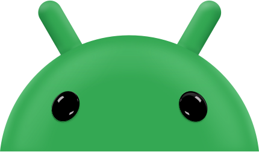

# Android Club
### VIT Bhopal University

*If it's Android, it's Us.*

[](package.json)
[](package.json)
[](package.json)
[](src/app/globals.css)

[Android Design Language](#android-design-language) · [Visual Tour](#visual-tour) · [Engineering](#engineering) · [Run Locally](#run-locally)

</div>

---

> **Personal Note**
>
> Looking at the current Android Club website, I noticed it did not reflect Google's Android design identity despite representing an Android developer community. For this build, I set out to design and engineer a club website grounded in Google's **Android Material Design 3 (Expressive)** philosophy, pairing live Monet dynamic color extraction, tactile Android geometry, and Android Robot character with fast, mobile-first Next.js engineering.

---

## Android Design Language

Rather than adopting generic web templates, every surface, transition, and component follows Google's **Material Design 3 Expressive** system and Android brand identity:

- **Tonal Surface Hierarchy**: Pixel Carbon dark mode (`#0C100D` / `#131915` / `#1A221D`) and warm Material light surfaces (`#F8FAF8` / `#EEF3EE` / `#FFFFFF`) anchor every card, paired with official **Android Green** (`#3DDC84`). Theme state initializes before first paint in [src/app/layout.tsx](src/app/layout.tsx) to avoid flicker.
- **Live Monet Dynamic Seed Engine**: The **Material You Color Picker** in the Domains section lets visitors switch the site's seed color live between **Android Botanical** (`#3DDC84`), **Pixel Cobalt** (`#4C8DF6`), **Bhopal Clay**, and **Citron Gold**. Selecting a seed recalculates CSS variables (`--m3-primary`, `--m3-primary-container`, `--m3-secondary-container`) across components, buttons, and Bugdroid accents immediately.
- **Official `@material/web` Motion & Shape Tokens**: Defined directly in [src/app/globals.css](src/app/globals.css), using Material emphasized easing curves (`--md-sys-motion-easing-emphasized`, `--md-sys-motion-easing-emphasized-decelerate`), structured corner radii (`8px` to `28px` and full pills), and layered tonal elevations.
- **Material 3 Expressive Geometry & Inverted Cutouts**: 12-sided scalloped starburst badges (`M3Starburst`), sawtooth pills (`M3JaggedBadge`), Pixel device hardware frames around open-source builds, and `InvertedCutoutCard` concave corner pockets calculated dynamically with `ResizeObserver` and quadratic Bezier SVG `<clipPath>` geometry (`buildCutoutPath`).
- **Bugdroid & Androidify Identity**: Interactive 3D Bugdroids (`BugdroidRig`, `android-head_3D.svg`) plus a prompt-driven **Androidify Studio** preview card matching Google's playful character customization language.
- **Google Font Stack**: `Plus Jakarta Sans`, `Roboto Flex`, and `JetBrains Mono` loaded via `next/font/google` with `display: "swap"`.

---

## Visual Tour

### Light & Dark Hero Architecture

| Pixel Carbon Dark (`#0C100D`) | Clean Material Light (`#F8FAF8`) |
| :---: | :---: |
| 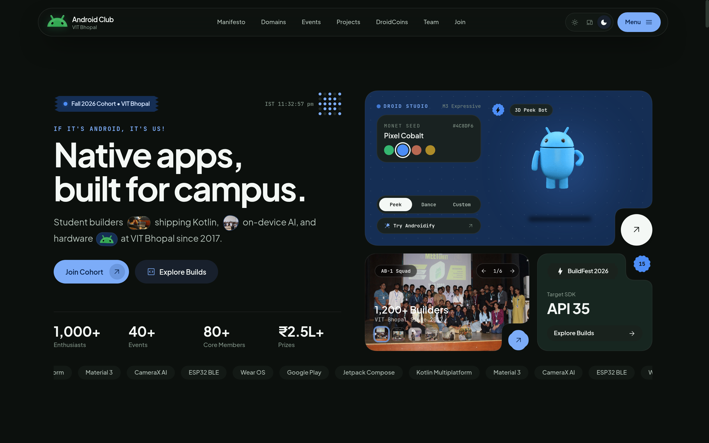 | 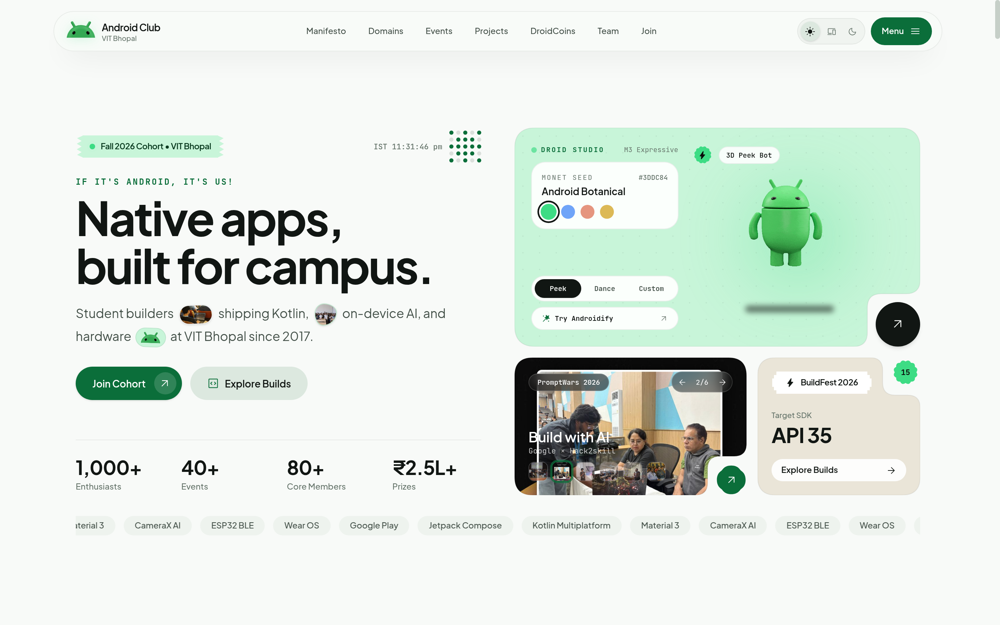 |

---

### Live Monet Engine & Chapter Pillars

Four core engineering tracks (**Native Android**, **Flutter & KMP**, **Material You Design**, and **On-Device AI & IoT**) arranged inside an expressive Material 3 bento grid alongside the live **Material You Color Picker** and `ColorScheme.kt` preview.

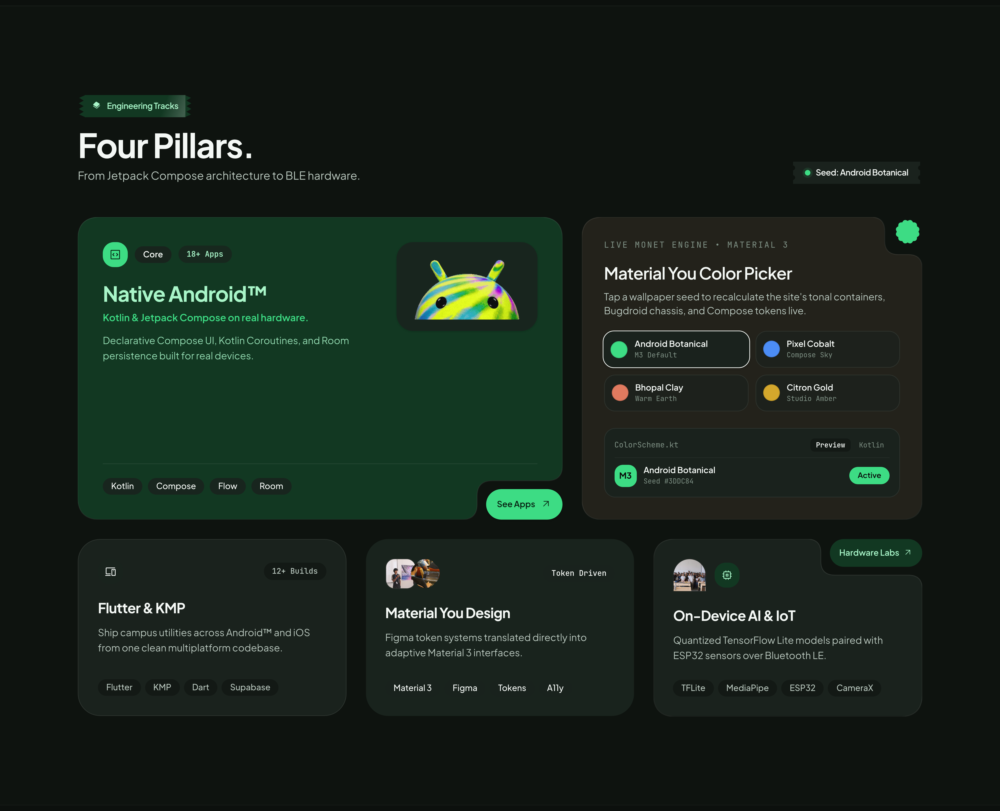

---

### Manifesto, Androidify Studio, Events & Shipped Software

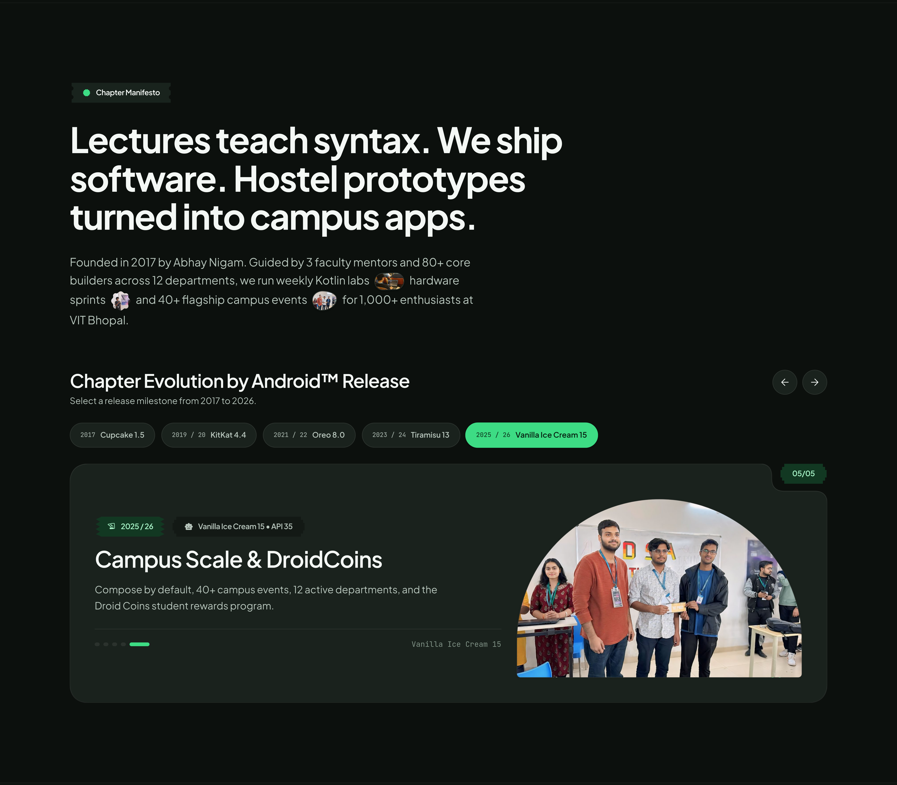

| Androidify Custom Bot Studio | Chapter Events & Arenas |
| :---: | :---: |
| 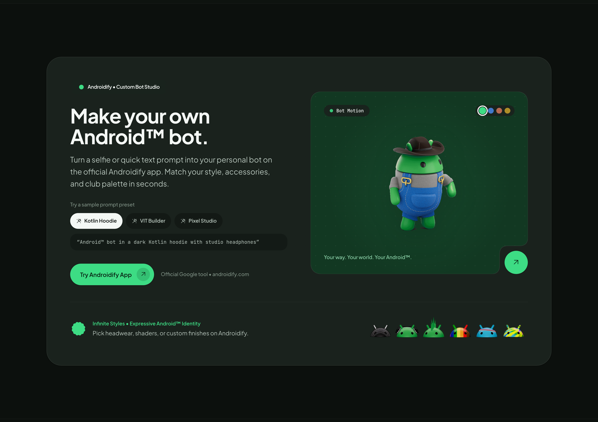 | 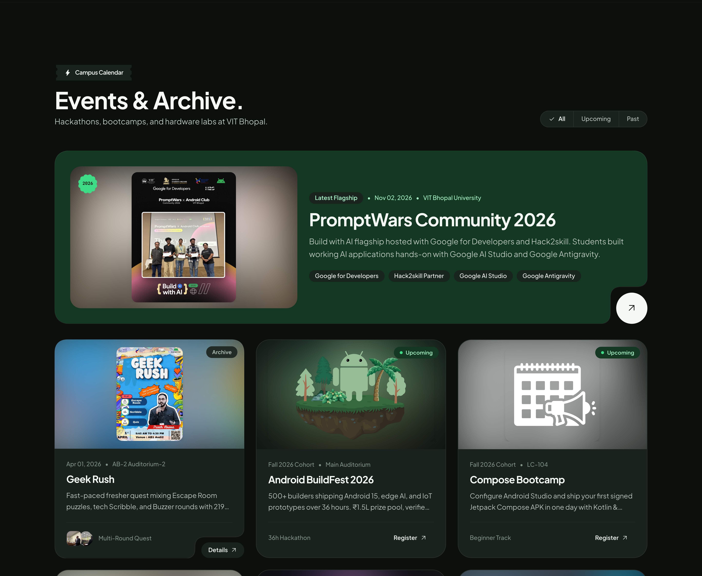 |

| Pixel-Framed Open-Source Software | Droid Coins Vault |
| :---: | :---: |
| 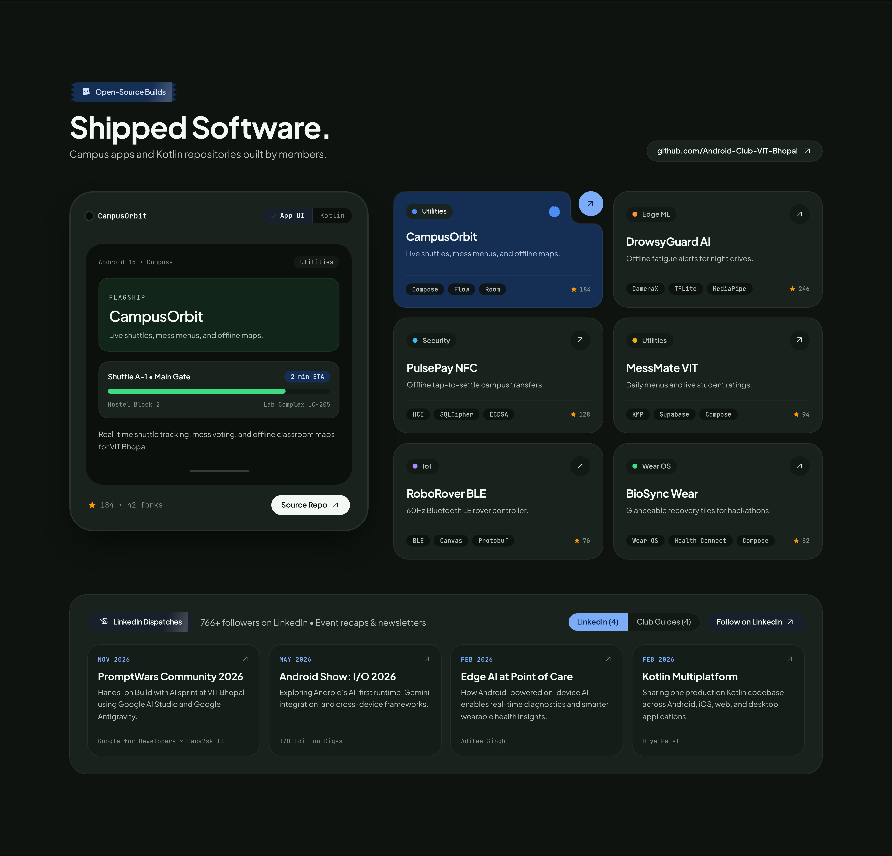 | 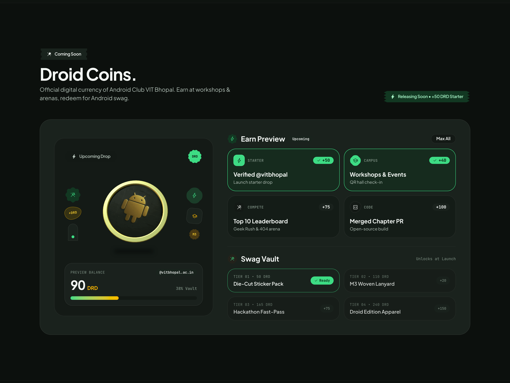 |

---

### Core Council (2026 - 2027), Recruitment & Campus Map

Departmental roster filtering (`SDC` view shown below), recruitment FAQ accordion, and the footer housing a live dark-mode Google Map pinned to **VIT Bhopal University** alongside the rising 3D Android return-to-top trigger.

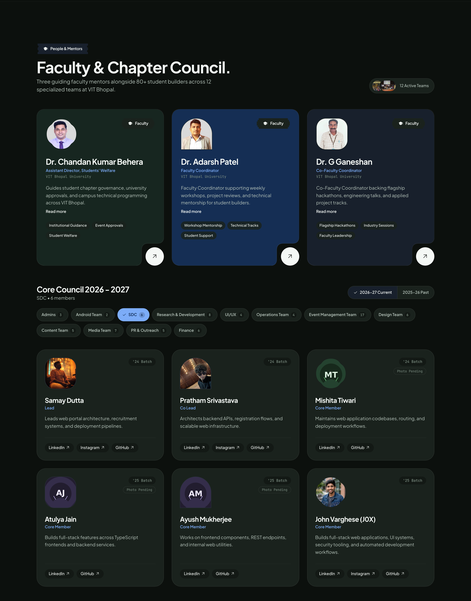

| Chapter FAQ & Application Form | Branded Footer & Live Campus Map |
| :---: | :---: |
| 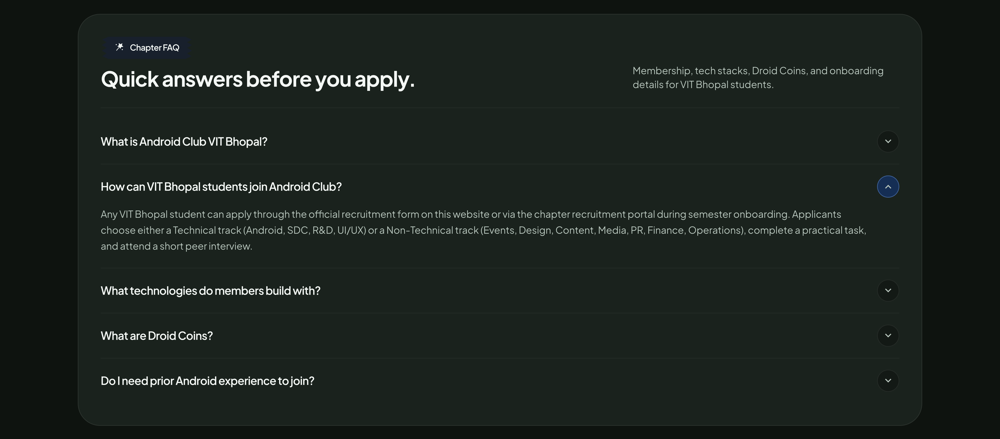 | 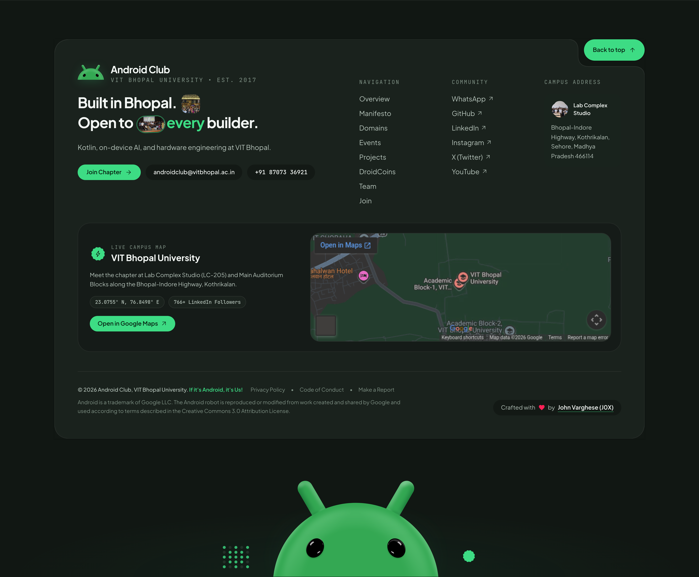 |

---

### Mobile-First Responsive Layout (`390x844` Verified)

Designed mobile-first with touch-ready hit targets, clean card stacking, and verified zero horizontal overflow (`scrollWidth === innerWidth`) at `390px`.

| Mobile Hero & Navigation | Mobile Open-Source Builds |
| :---: | :---: |
| 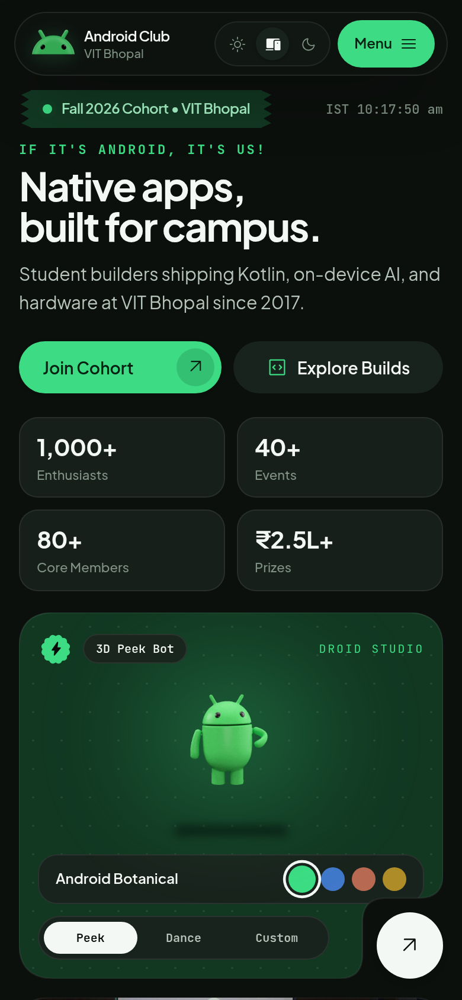 | 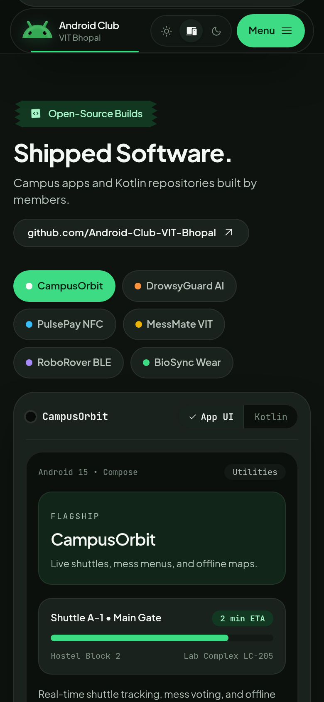 |

---

## Engineering

### Tech Stack

| Layer | Technology | Role |
| :--- | :--- | :--- |
| **Framework** | Next.js `16.4.6` (App Router, Turbopack) | Static pre-rendering, metadata routes, asset caching |
| **UI Runtime** | React `19.1.0` & TypeScript `5.8.0` | Strictly typed component architecture and section data |
| **Styling & Design System** | Tailwind CSS `4.1.0` & `@material/web` CSS Tokens | Pixel Carbon / light tonal surfaces and dynamic Monet seeds |
| **Motion & Scrolling** | GSAP `3.12.7` + Lenis `1.3.4` | ScrollTrigger reveals synced with smooth scrolling and reduced-motion guards |
| **Typography** | `Plus Jakarta Sans`, `Roboto Flex`, `JetBrains Mono` | Variable display, UI, and code typography via `next/font/google` |
| **SVG & Cutout Geometry** | Custom SVG `<clipPath>` + `ResizeObserver` | Dynamic concave cutouts (`InvertedCutoutCard`) and Material 3 badges |
| **Tooling** | ESLint `9.22.0` (`eslint-config-next`), `clsx` `2.1.1` | Code quality linting and conditional class composition |

### Technical Highlights

- **Single-Source Typed Data**: Chapter metrics, tracks, events, projects, FAQ items, Droid Coins rewards, and team directories live in [src/data/club.ts](src/data/club.ts), cleanly decoupled from presentation components.
- **Zero-Shimmer Cached Images**: `SmartImage` detects already-decoded browser assets (`complete && naturalWidth > 0`) and renders immediately without skeleton flicker, backed by 1-year immutable `Cache-Control` headers for `/assets/` in [next.config.ts](next.config.ts).
- **Accessible Motion Guardrails**: GSAP `3.12.7` ScrollTrigger animations sync with Lenis `1.3.4` smooth scrolling in [src/lib/motion.ts](src/lib/motion.ts) and turn off automatically when `prefers-reduced-motion` is enabled.
- **SEO, GEO & AEO Coverage**: Full `Schema.org` JSON-LD graph (`Organization`, `WebSite`, `Event`, `FAQPage`) in [src/app/layout.tsx](src/app/layout.tsx), plain-text AI knowledge endpoint at [public/llms.txt](public/llms.txt), crawler routes (`/robots.txt`, `/sitemap.xml`, `/manifest.webmanifest`), and [public/humans.txt](public/humans.txt).

---

## Run Locally

Requires **Node.js 20+** and **npm 10+**.

```bash
git clone https://github.com/Android-Club-VIT-Bhopal/Android-Club-Website.git
cd Android-Club-Website
npm install
npm run dev
```

Open `http://localhost:3000` in your browser.

### Quality Checks & Production Build

```bash
npx tsc --noEmit
npm run lint
npm run build
npm run start
```

---

## Legal & Author

Android is a trademark of Google LLC. The Android robot is reproduced or modified from work created and shared by Google and used according to terms described in the [Creative Commons 3.0 Attribution License](https://creativecommons.org/licenses/by/3.0/). Fonts load under the SIL Open Font License.

Designed and engineered by **John Varghese (J0X)**:
- **GitHub**: [John-Varghese-EH](https://github.com/John-Varghese-EH)
- **LinkedIn**: [/in/John--Varghese/](https://www.linkedin.com/in/John--Varghese/)

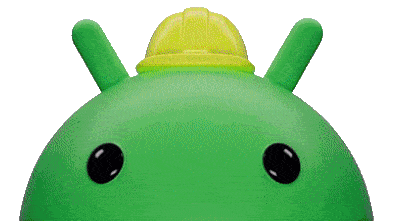
